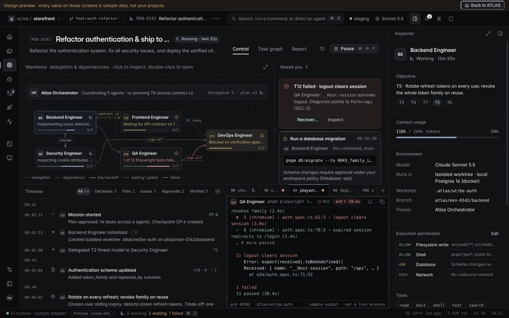

# ATLAS

## Cloudflare challenge edition — October 14, 2026

This edition adds Mac setup fixes, a reproducible concurrent-agent demo, nine API-key provider inputs with model selection, and a Workers + Artifacts publication integration.

**Deployment status:** local Mac missions are tested. The Cloudflare Worker is deployed with an Artifacts binding, and a live concurrent mission was published to a per-mission Artifacts repository with every commit hash independently verified (`pnpm test:cloud-live`, see [docs/CLOUDFLARE.md](docs/CLOUDFLARE.md)).

- [Run on your Mac and configure model keys](docs/MAC-SETUP.md)
- [Cloudflare integration and deployment](docs/CLOUDFLARE.md)
- [Submission draft and remaining requirement](docs/SUBMISSION.md)
- [Validation report](docs/VALIDATION-2026-10-14.md)

For the concurrent sample, use the objective `[parallel sample] Fix slugify and add regression coverage in parallel, then review and verify the integrated result.` Select the scripted runtime; decisions are scripted, while worktrees, scheduling, edits, integration and checks are real.


Local-first mission control for autonomous software engineering. You open a repository and describe an outcome. ATLAS proposes a plan for you to approve. It then runs agents in isolated git worktrees inside an OS sandbox, through policy-governed tools, integrates their work, and verifies the result independently: tests, review, browser and API checks, and optionally a staging deployment whose served revision it reads back. It shows you the evidence, and you accept or reject the change. Your checkout is never edited.

> An agent claim is not evidence. ATLAS marks work verified only on a real process exit, test assertion or operator decision.

This implements milestones **M0–M5** of the [implementation manual](docs/spec/manual.md):
- multi-agent DAGs with review and delegation;
- browser QA;
- staging deployment with verified rollback;
- desktop control on a disposable virtual display;
- an evaluation corpus.

See [what is met, with evidence, and what is not](docs/spec/status.md), and the latest [evaluation report](docs/eval/latest.md).


## Product tour

Every screenshot below was captured from the built Electron app running a real mission on the bundled sample project (`pnpm screenshots` regenerates them). The agent is the scripted runtime; the git worktree, commands, test runs, approvals and evidence are real.

### Projects
Open any local folder with **Open repository** (⌘O). Each project card shows the real branch, HEAD, uncommitted-change count and its missions with their outcome. An empty state explains what ATLAS will and won't touch.

| Empty | With a project |
| --- | --- |
|  |  |

### Mission composer with preflight
Choose the repository, describe the outcome, add constraints, then pick an **approval mode** (ask for risky actions · ask for every write · read-only) and a **runtime** (scripted, or Pi when a provider key is set). **Preflight** runs live as you change options and blocks on real problems: not a git repo, no commits, runtime unavailable. It warns about uncommitted changes, missing tests and the absence of a deploy target.


### Plan review before anything runs
The validated plan lists each task, its acceptance criteria, the exact tools it may request, what will ask you first, and how ATLAS will verify the result. Nothing executes until you approve it.


### Live execution and approvals
- **Needs you**: each approval card states *who* (agent role), *what* (the exact path or command), *where* (worktree), *what it touches*, *for how long* (once) and *why it was asked*, with a live expiry countdown. Approve once or deny.
- Pending decisions surface everywhere: a **"needs you" chip** in the title bar, an amber rail badge, the **status bar count**, the **window title** (`(1) … — ATLAS`), and a toast if you're on another screen.
- **Process output** streams the real stdout/stderr of each command, with exit codes and durations.
- **Tasks** shows state and attempt number, with a per-task **Stop** and a mission-level **Cancel** that kills the whole process tree.

### Activity timeline
An ordered, resumable audit trail: plan, policy denials, tool calls, commands, checkpoints, checks and your decisions, each with actor and time. **Filter chips** (All · Agent · Commands · Policy & approvals · Checks) show live counts. Long output such as stack traces **collapses** with a "Show N more lines" expander. Agent summaries are labeled *a claim, not evidence*.

| Full timeline | Filtered to policy & approvals |
| --- | --- |
|  |  |

### Changes and evidence
**Changes** renders the checkpointed patch per file, with +/− counts and branch/base identity. Untrusted content is always shown as text, never HTML. **Evidence** shows the release-gate verdict in words, each check's result, command, commit, duration and full log, plus an explicit list of what this release does **not** verify. **Accept** keeps the branch for you to merge; **Reject** removes the worktree and branch. Neither touches your checkout.

| Changes | Evidence |
| --- | --- |
|  |  |

### Task graph, integration and review
Model plans pass the same validator as everything else (role/tool allowlists, no cycles, task limits; one repair round, then the deterministic plan).

**Tasks** draws the DAG:
- independent tasks run in parallel worktrees, up to the budget;
- a dependent task starts from its dependencies' checkpoints;
- writers that declare the same files are serialized;
- delegated subtasks hang off their parent (dashed);
- every writer is merged into `atlas/<mission>/integration`, and a conflict stops the mission instead of being guessed.

**Review** lists structured findings. *Confirmed* requires a failing command ATLAS itself ran in that review. You can dismiss, accept the risk, mark fixed and re-run the release gate without repeating agent work. The side panel meters tokens, agents, tasks and wall clock against the mission budget.

| Task graph | Mission composer: target environment and budget |
| --- | --- |
|  |  |

### Browser QA and API checks
If the project has an `atlas.config.json`, ATLAS starts the app from the checkpointed commit inside the sandbox. It checks its endpoints and drives its browser flows in an isolated Chromium context that may only reach the app's origin, recording a screenshot per step and a trace. Console errors fail the flow. A `browser_qa` agent can drive the same session through `browser_action`.


### Staging deployment with independent verification
Choose a target environment in the composer. The target must be defined in the project config **and** on your allowlist in Settings, and every deployment asks for your approval.


After deploying, ATLAS verifies on its own instead of trusting the provider:
- it reads the served revision back (a different or unknown revision fails);
- it checks readiness, synthetic traffic (error rate, p95), and the API checks and browser flows against the deployed URL;
- it scans the logs;
- it hashes everything into a manifest.

A failed verification rolls back to the last verified deployment and re-reads the revision to confirm it. An interrupted deployment is marked *unknown* and never silently retried. Production is never available.


### Desktop control on a disposable virtual display
A `desktop_operator` agent gets a new, empty Xvfb display for one attempt. Your own desktop is never captured or controlled. It needs **Settings → Desktop control** turned on *and* an approval for each session. Apps it launches run in the sandbox with only that display's socket.

The **Desktop** tab streams the display. You can **take over** (agent input is refused while you hold it), **pause** (no further input, even mid-typing), hand back or stop. Every input leaves a screenshot and an audited event.

| Agent in control | You took over |
| --- | --- |
|  |  |

### Operator terminal, audit export and import
- **Terminal** opens a real PTY in a task worktree or the integration branch, in the same sandbox as agent commands. It is read-only while an agent holds that worktree.
- **More → Export audit log** writes a versioned JSONL with redaction re-applied and a SHA-256 trailer.
- **Projects → Import audit log** verifies it and opens it as a read-only archive.
- Missions can be deleted, and **retention** purges old decided missions automatically.


### Settings for the new capabilities
- **Execution isolation:** sandbox status, and an explicit two-step opt-in for unsandboxed execution.
- **Desktop control.**
- **Deployments:** allowlisted targets, automatic rollback, and per-target secrets (stored with the OS credential store; names only ever shown).
- **Retention.**
- **Agent roles:** versioned definitions with their tools, policy capabilities and budgets.

| Desktop control and deployments | Agent roles |
| --- | --- |
|  |  |

### Command palette (⌘K)
Jump to any mission (fuzzy search over titles, IDs and objectives), start a mission in a specific project, open a repository or go to any screen. Missions waiting on you are listed first. Fully keyboard-driven: ↑ ↓ ↵ esc.


### Settings
Health of each runtime, provider keys stored with the OS credential store (never shown again, redacted everywhere), and versions with Pi provenance (package, commit, license).


### Design preview
The original design-system prototype stays available from the rail, under a persistent banner that says it is sample data.



### Interaction details
- **Keyboard**: ⌘K palette · ⌘O open repository · ⌘N new mission · ⌘1 projects · ⌘, settings (Ctrl on Linux/Windows).
- **Resilience**: if the daemon crashes, the status bar shows *Daemon restarting*, the shell restarts it, and every open view resyncs from the event log with no gaps or duplicates. App restarts restore the last screen.
- **Honest states**: verified (green) only on a passing required check; *unverified* (amber) when no checks exist; *failed* (coral) otherwise. Every state carries a word or glyph, never color alone.
- **Design system**: dark, near-monochrome "Obsidian" theme; Inter / Inter Display / DejaVu Sans Mono; one accent per view; hairline separation; 4px grid. See [docs/design/DESIGN.md](docs/design/DESIGN.md).

## Quick start

```bash
corepack enable          # pnpm 10
pnpm install
pnpm run doctor              # checks Node, git, Electron, sandbox, browser, desktop tools, credentials (values never printed)
pnpm seed:sample         # creates ~/atlas-sample-app: a small project with a real bug and real tests
pnpm dev                 # launches the desktop app
```

In the app: **Open repository** → choose `~/atlas-sample-app` → **New mission** → describe the fix → **Plan mission** → review the plan → **Approve plan and start**. Watch the coder read the code, run the failing tests, edit `src/slugify.js` in its own sandboxed worktree and re-run them. A reviewer then checks the change.

ATLAS integrates the result and runs everything itself on the integrated commit:
- the tests;
- the app's API checks;
- the browser flow.

It then shows **Verified: …**, the diff and the logs. **Accept changes** keeps `atlas/<mission>/integration` in your repository for you to merge. **Reject changes** removes it.

More to try with the same sample:
- **Staging:** in Settings → Deployments, allow `local-staging`, then choose it as the target environment. Approve the deployment when asked and open the **Deploy** tab.
- **Desktop:** turn on Settings → Desktop control, then start a mission whose objective contains `[desktop sample]`. Approve the session, open the **Desktop** tab and take over while the agent works.

The sample mission uses the **scripted runtime**, which needs no model or credentials. Its tool calls, commands and checks are real; only the decisions are scripted, and the UI labels it. To run a real model, add a provider key in **Settings** (Anthropic, OpenAI or Google; stored with the OS credential store) and choose **Pi** when creating a mission.

## What a mission does

1. **Preflight** blocks or warns about:
   - uncommitted changes;
   - missing tests;
   - no sandbox;
   - missing credentials;
   - the app and browser checks that will run;
   - the deploy target and whether it is allowlisted.
2. **Plan**: a validated plan (tasks, roles, dependencies, acceptance criteria, tools, verification, budget). Nothing runs until you approve it.
3. **Execute**: each task runs in `<data>/worktrees/<mission>/<task>` on its own branch, inside the OS sandbox. Every tool call passes the policy engine:
   - reads, edits inside the worktree and safe commands (`npm test`, `git status`, …) run directly;
   - installs, network clients, deletes, git writes, shells and unknown programs wait for a **single-use approval** that states who, what, where, what it touches, for how long and why. Network egress is opened only for an approved network command;
   - `sudo`, path escapes, `.git` writes, credentials and production deploys are always denied. Staging deploys and desktop sessions have their own approvals.
4. **Integrate and verify**: writers merge into the integration branch. ATLAS then runs on the integrated commit:
   - the project's checks (`test`, `typecheck`, `lint`, plus `atlas.config.json` checks);
   - the review gate;
   - browser and API checks;
   - optionally a staging deployment with independent verification.

   The release gate reports *verified*, *unverified* or *failed*. Only a real pass counts as evidence, and a clean review is a gate, never evidence.
5. **Decide**: accept (the integration branch is kept) or reject (worktrees and branches removed).

Every step is an append-only event with actor, task, attempt and time. The timeline, process output, diff and check logs all come from that record. Closing the app, crashing the daemon or restarting resumes from it.

## Commands

| | |
| --- | --- |
| `pnpm dev` | Electron + Vite with live reload |
| `pnpm build` | renderer (Vite) + main, preload and daemon (esbuild) |
| `pnpm typecheck` / `pnpm lint` | strict TS per workspace; ESLint + dependency-graph check |
| `pnpm test` | unit tests — policy, state machines, plan validation, gate, storage, paths, executor, Pi contract |
| `pnpm test:integration` | full missions against temp git repos (approvals, denial, redaction, cancel, crash recovery) |
| `pnpm eval` | golden mission corpus with hidden oracles → [`docs/eval/latest.md`](docs/eval/latest.md) |
| `pnpm test:e2e` | Playwright drives the built Electron app (Linux: `xvfb-run -a pnpm test:e2e`) |
| `pnpm package` | electron-builder → `apps/desktop/release/` (Linux AppImage is the tested target) |
| `pnpm screenshots` | rebuilds and recaptures `docs/screenshots` from a live mission |
| `pnpm pi:version` | verifies the pinned Pi SDK (0.87.1, MIT) |

No test needs network access or model credentials. Pi's contract tests run the real SDK against its scripted provider.

## Architecture

```
renderer (React, sandboxed) ──intent──▶ preload (frozen window.atlas) ──▶ main (validates sender + zod schema)
                                                                              │
                                              ordered events ◀── daemon (utility process) ◀┘
                                                                 ├─ storage: SQLite (WAL) + checksummed artifacts
                                                                 ├─ orchestrator: plan → DAG schedule → ToolGate → integrate → verify → stages → gate
                                                                 ├─ policy: capabilities, role grants, approvals (default deny)
                                                                 ├─ workspace: worktrees, path checks, checkpoints, leases
                                                                 ├─ terminal: argv executor, bubblewrap sandbox, PTY, tree kill
                                                                 ├─ browser: Playwright sessions, app start, API checks
                                                                 ├─ deploy: staging providers, verification, rollback
                                                                 ├─ desktop-control: Xvfb displays, input lease
                                                                 └─ runtimes: scripted · Pi SDK (behind AgentRuntime)
```

[AGENTS.md](AGENTS.md) maps the code. Decisions are in [docs/adr](docs/adr); the visual language is in [docs/design](docs/design/DESIGN.md). The design-system prototype is still in the app under **Design preview** (rail, palette icon) and is labeled as sample data.

## Security model in one paragraph

The renderer has no Node access and can only send declared, schema-validated intents. Main checks that they come from its own window. The daemon re-validates them and owns all execution.

Agents never get a shell: they get governed tools. Policy is code evaluated before every call, and denied calls never reach an executor. Commands are argument arrays with a scrubbed environment.

Every agent command, check, app server, deploy command and operator terminal runs in a **bubblewrap sandbox**:
- no home directory and no other projects;
- the worktree as the only writable path;
- private PID and IPC namespaces;
- no network unless an approved command needs it.

If no sandbox is available, ATLAS fails closed unless you explicitly allow unsandboxed execution. Provider keys and deploy secrets live in the OS credential store and are redacted from events, logs, artifacts and exports. See [ADR 0007](docs/adr/0007-os-sandbox.md), [0010](docs/adr/0010-staging-deploy.md) and [0011](docs/adr/0011-desktop-control.md).

## Platform

Linux x64 is the tested platform; CI runs the Electron e2e suite there. Requirements:
- Node ≥ 22.19 and git;
- bubblewrap for the sandbox;
- for browser checks, Chromium (Playwright's build or a system Chrome);
- for desktop control, Xvfb, xdotool and ImageMagick.

`pnpm run doctor` checks all of these. macOS (sandbox-exec profile) and Windows builds are configured but untested and unsigned; desktop control is Linux-only.
