# ATLAS — mission control for a team of AI software engineers

**Many agents change one repository at the same time. Nothing reaches your code until ATLAS has proven the change works — and you decide.**

ATLAS is a desktop app. You describe an outcome; an orchestrator model plans it into a task graph and staffs it with specialists (coders, testers, a reviewer, a security engineer, browser QA, a deployment verifier). They work **concurrently in isolated git worktrees inside an OS sandbox**, ATLAS integrates their work, **verifies it independently** (tests, API checks, a real browser, visual diffs, a staging deploy it reads back), opens a **GitHub pull request** where CI runs, and publishes every checkpoint to **Cloudflare Artifacts** through a Cloudflare Worker that reads each commit back before ATLAS records it.

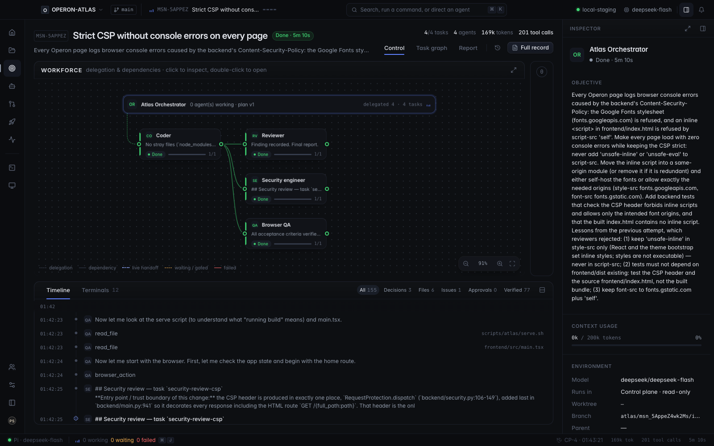

---

## Built for the Cloudflare "next-gen Git platform" challenge

| The challenge asks for… | ATLAS |
| --- | --- |
| A new way for **multiple agents to work on changes concurrently** | A **mission** is the unit of work: a model-proposed, validated task graph. Independent tasks run at the same time, each agent in its own git worktree and branch; dependent tasks start from their predecessors' checkpoints. |
| Rethinking **repositories, branches, pull requests, worktrees** | Every task gets a worktree and branch (`atlas/<mission>/<task>`); ATLAS checkpoints each one, integrates them into a mission branch, and only then opens a pull request — one PR per verified mission, not per agent. |
| Rethinking **code review** | Review is a role, not a rubber stamp: a reviewer and a security engineer pin findings to diff lines; a finding is *confirmed* only with a failing reproduction ATLAS ran itself. A clean review can gate, but never counts as evidence. |
| Rethinking **merge conflicts** | Writers that declare overlapping files are serialized; a real conflict **stops integration** and is shown to you instead of being papered over. (It happened on a real run — see [Results](#results-on-a-real-product).) |
| Built with **Cloudflare Workers + Artifacts** | `cloudflare/` is a Worker with an **Artifacts binding**. Per mission it creates a repository, issues a 10-minute repo-scoped git token, receives the base, every agent branch and the integration branch, then **reads every ref back** through the Artifacts API; ATLAS records the publication only if every commit ID matches. Live-verified. |
| Open source + instructions to run | MIT licensed. Setup below takes ~5 minutes on a Mac. |

---

## How a mission works

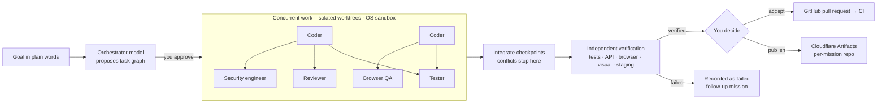

- **An agent's claim is never evidence.** Only checks ATLAS runs itself can make a mission *verified*.
- **Every tool call goes through policy** (allow / ask / deny) and runs as an argument array inside the sandbox; risky actions wait for your approval, once.
- **Your checkout is never edited.** Agents work in worktrees; accepted work lands as a branch and a pull request.

### Cloudflare Artifacts publication

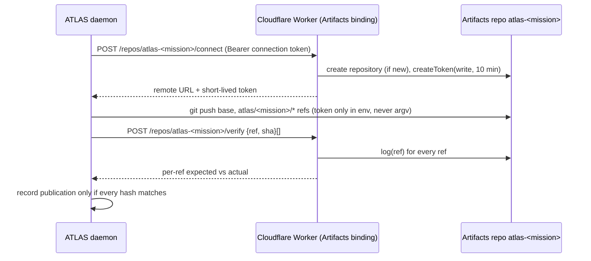

---

## Results on a real product

We pointed ATLAS at **Operon**, a complaint-operations platform (FastAPI + React, ~600k lines including data), with **DeepSeek** models through the official API.

- The orchestrator model planned each mission itself — e.g. CSV export: 8 tasks across coders, testers, a reviewer, a security engineer, browser QA and a deployment verifier, with dependencies; writers ran in parallel.
- ATLAS **deployed Operon to staging**, read the served revision back, ran 20 synthetic requests (0 errors) and all API checks.
- The security engineer found real issues (an export not bounded in memory; a missing role check on bulk export).
- **Strict CSP fix:** the first attempt hit a merge conflict between two parallel writers (integration refused it); the second was rejected by reviewers (confirmed findings); the third passed every check — backend tests, frontend tests/types/lint/build, 5 API checks, 4 browser flows with zero console errors — was accepted and **pushed as [a pull request](https://github.com/premalshah999/OPERON-ATLAS/pull/1) from the app; GitHub Actions: backend, frontend and smoke all green.**

- The verified mission was then **published to Cloudflare Artifacts from the app**: repository `atlas-msn_5AppeZ4wk2Ms`, every ref read back by the Worker as matching.

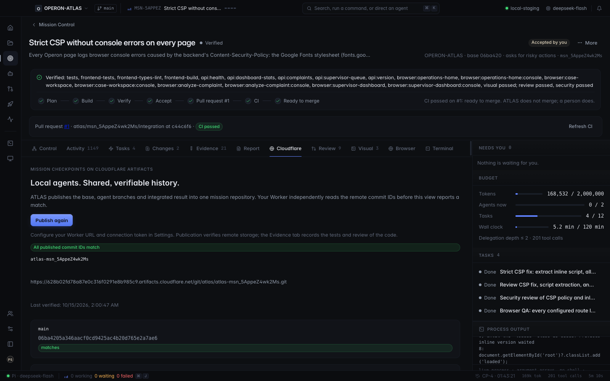

Failures were recorded as failures. That is the point.

---

## A tour

| | |
| --- | --- |
| 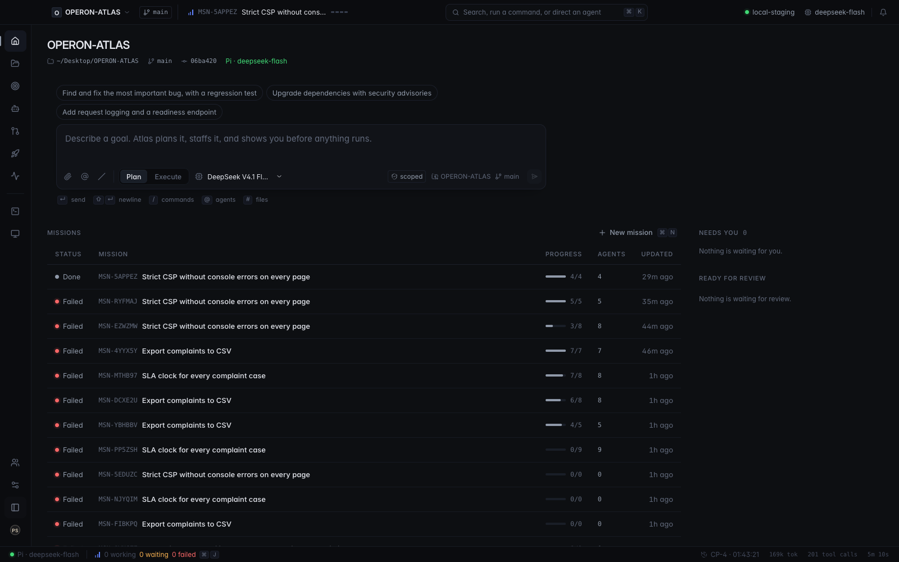 **Home** — what needs you, what is running, what is ready for review. | 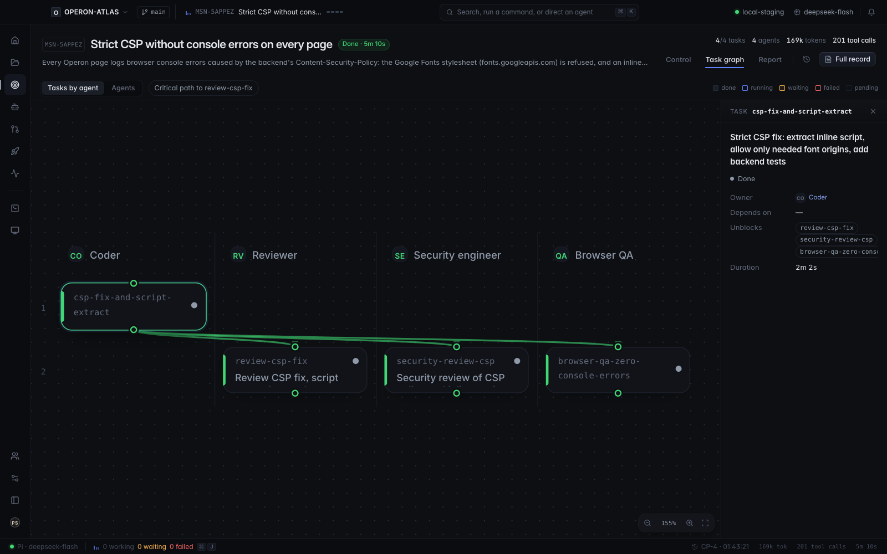 **Task graph** — the real dependency structure, laid out automatically; pan, zoom, critical path. |
| 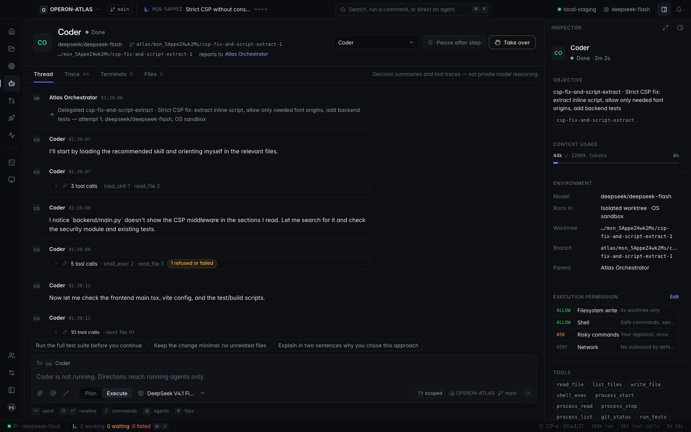 **Agent detail** — decisions and every tool call; the composer **directs a running agent** inside its live session. | 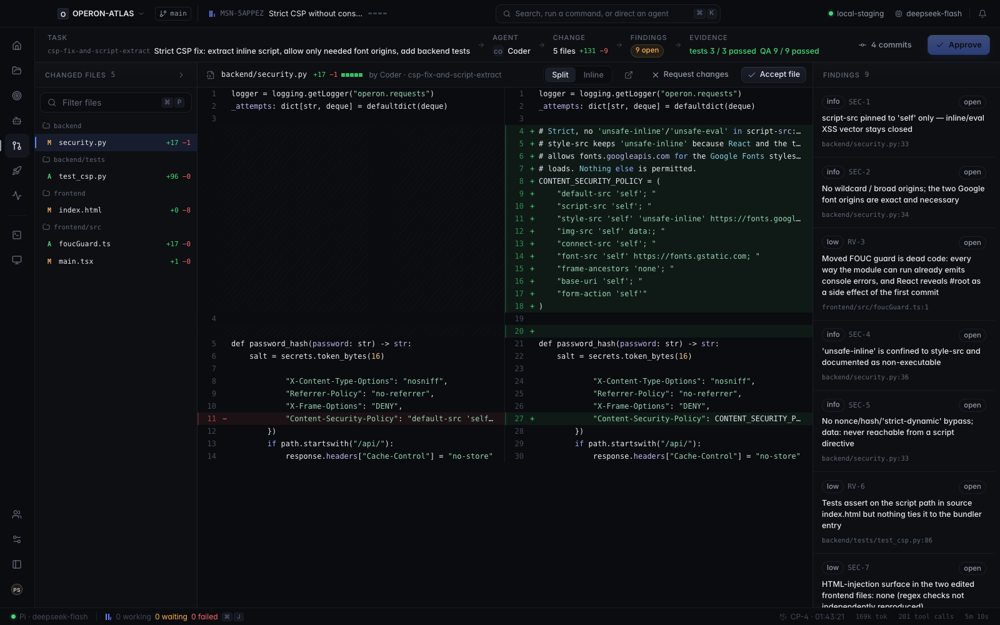 **Review** — the patch file by file with findings pinned to lines. |
| 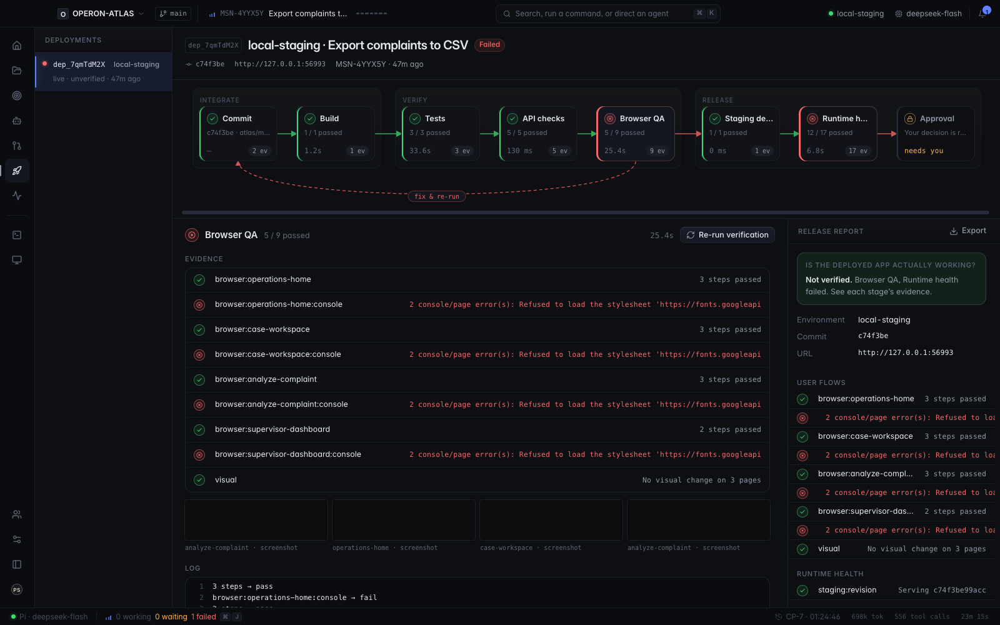 **Deployment cycle** — Integrate → Verify → Release, with a fix-and-rerun loop and a release report. | 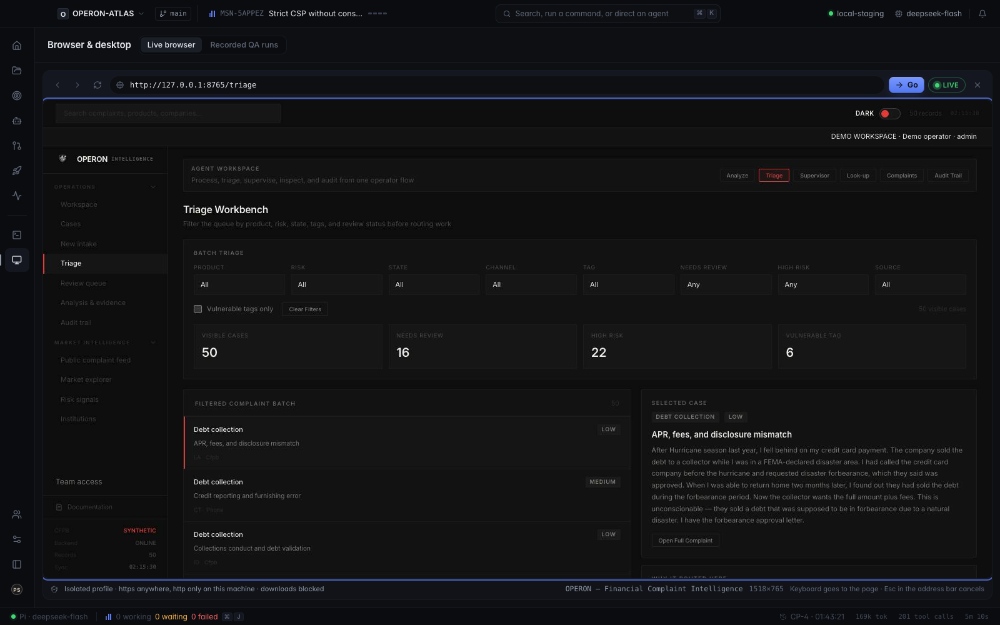 **Live browser** — a real, interactive browser on the app under test (here: Operon running the agents' fix); plus every recorded QA step. |
| 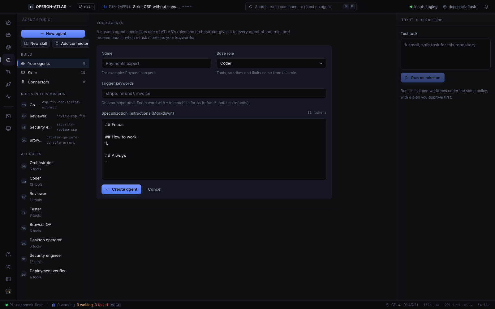 **Agent Studio** — every role as enforced policy; **create your own agents, skills and connectors (MCP)**. | 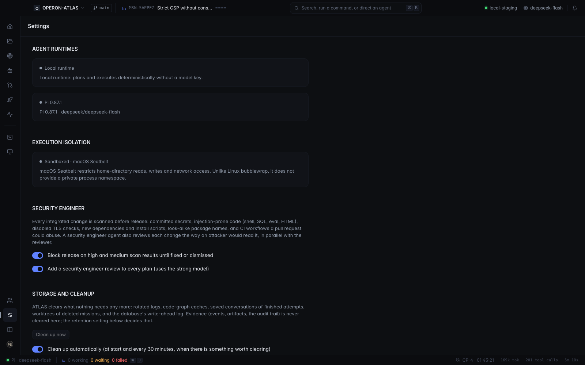 **Settings** — every key-based model provider, live key checks, models per tier, Cloudflare, GitHub. |

---

## Get started (macOS)

**Requirements:** macOS 14+, Node.js 22.19+, pnpm 10.28, git, Xcode Command Line Tools.

```sh
git clone https://github.com/premalshah999/ATLAS-Cloudflare && cd ATLAS-Cloudflare
pnpm install --frozen-lockfile
node node_modules/electron/install.js
pnpm exec playwright install chromium
pnpm build && pnpm start
```

1. **Open a repository** (any git project). Optional: `pnpm seed:sample ~/atlas-example` creates a small project with a real bug and real tests to try first.
2. **Add a model key** — Settings → Model providers. DeepSeek, Anthropic, OpenAI, Google, Mistral, xAI, Groq, OpenRouter and every other key-based provider are supported. **Test** checks the key against the provider's own API (DeepSeek: also your balance). Choose a model per tier (strong / default / fast).
3. **Create a mission** from Home or New mission. Approve the plan. Watch Mission Control; approve risky steps when asked; direct any running agent.
4. **Decide.** Accept to keep the integration branch, or **Publish** it as a GitHub pull request (ATLAS uses your GitHub CLI sign-in — `gh auth login` — or a token in Settings).

To package a Mac app: `CSC_IDENTITY_AUTO_DISCOVERY=false pnpm exec electron-builder --mac dir --projectDir apps/desktop` → `apps/desktop/release/mac/ATLAS.app`.

### Connect Cloudflare Artifacts

Artifacts requires the Workers Paid plan.

```sh
pnpm cloud:login            # wrangler login
pnpm cloud:deploy           # deploys the Worker with its Artifacts binding (namespace "atlas")
pnpm cloud:secret           # set ATLAS_CLOUD_TOKEN (a random 32+ char secret)
```

Put the Worker URL and the same token in **Settings → Cloudflare Workers + Artifacts**. On a completed mission open **Full record → Cloudflare → Publish to Cloudflare**; every ref shows *matches* when the Worker has read it back. Live check from the CLI:

```sh
ATLAS_CLOUD_URL=https://<worker>.workers.dev ATLAS_CLOUD_TOKEN=<token> pnpm test:cloud-live
```

### Make your project verifiable

Add an `atlas.config.json` to your repository to tell ATLAS how to check it — test commands, how to start the app for browser/API checks, browser flows, and a staging deploy:

```json
{
  "version": 1,
  "checks": [{ "name": "tests", "command": ["npm", "test"] }],
  "app": { "start": ["npm", "start"], "readyPath": "/health" },
  "api": [{ "name": "health", "method": "GET", "path": "/health", "expectStatus": 200 }],
  "browser": { "flows": [{ "name": "home", "steps": [{ "action": "goto", "path": "/" }, { "action": "expectText", "text": "Welcome" }] }] },
  "deploy": { "target": "local-staging", "provider": "local", "versionPath": "/version" }
}
```

Without it ATLAS detects `npm test`, `typecheck` and `lint` scripts.

---

## Extend it: more agents, skills and connectors

- **Agents** — Agent Studio → *New agent*: give a specialization (instructions, base role, triggers). The orchestrator hands it to every agent of that role.
- **Skills** — reviewed procedures agents load on demand (e.g. *test-first*, *skeptical review*). Create, import from a repository, enable or disable; sync them to Claude Code, Codex and OpenCode.
- **Connectors** — MCP servers, remote (streamable HTTP) or local (sandboxed stdio), behind a governed `mcp_call` tool with per-server secrets.
- **Web access** — pooled search accounts (Tavily, Brave, Google), page fetch and read-only browsing with a public-address guard.

---

## Security model

- The renderer has no Node access and can only send declared, schema-validated intents; the daemon owns all execution.
- Agents never get a shell — they get governed tools. Policy is evaluated before every call; denied calls never execute.
- Every command runs as an argument array in an OS sandbox (macOS Seatbelt / Linux bubblewrap): only the worktree is writable, no home directory, no network unless approved.
- Keys live in the OS credential store and are redacted from every log, event and export. Model keys never reach Cloudflare; the Worker only sees a connection token and issues short-lived repo-scoped tokens.

---

## For developers

```
apps/desktop      Electron: main (windows, IPC, credentials), preload, renderer (React dashboard)
apps/daemon       control plane: storage, orchestrator, runtimes, Cloudflare publication, live browser
packages/*        contracts, storage (SQLite), policy, workspace (worktrees), terminal (sandbox, PTY),
                  orchestrator (plan, schedule, ToolGate, verify, gate), browser, deploy, mcp, web,
                  team, security, graph, runtime-pi (Pi SDK), runtime-fake (local runtime), cloudflare
cloudflare/       the Worker (Artifacts binding) and its tests
```

| Command | |
| --- | --- |
| `pnpm typecheck` / `pnpm lint` | types and lint across the workspace |
| `pnpm test` | unit tests (350+) |
| `pnpm test:integration` | orchestration against real git repositories |
| `pnpm test:e2e` | drives the built Electron app with Playwright |
| `pnpm test:cloud-live` | publishes a real mission to Cloudflare Artifacts and verifies every hash |

More: [docs/CLOUDFLARE.md](docs/CLOUDFLARE.md) · [docs/MAC-SETUP.md](docs/MAC-SETUP.md) · [docs/adr](docs/adr) · [AGENTS.md](AGENTS.md)

MIT License.
